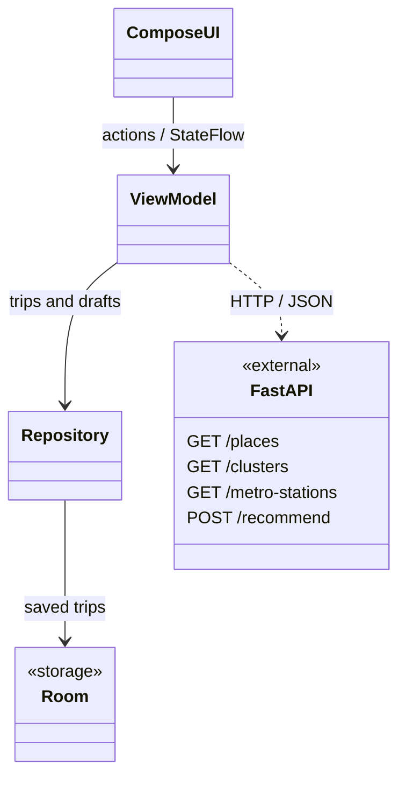

# Travel Planning — Мгновения Петербурга

Android-приложение для поиска интересных мест и планирования прогулок по Санкт-Петербургу. Помогает выбрать локации по интересам, составить свою поездку и сохранить места, даты и заметки.

## Возможности

- Каталог городских мест с поиском, категориями, фотографиями и подробной информацией.
- Персональный подбор мест по интересам, выбранному метро и количеству локаций.
- Создание, редактирование и удаление поездок.
- Добавление и удаление мест в поездке, сохранение дат и заметок.
- Обмен списком мест со ссылками на Яндекс Карты.
- Локальное хранение поездок и кэширование загруженного каталога и изображений.

Для первоначальной загрузки каталога и получения рекомендаций нужен интернет. Ранее загруженные данные и сохранённые поездки доступны локально.

## Как выглядит приложение

<table>
  <tr>
    <th>Главный экран</th>
    <th>Поиск и выбор мест</th>
    <th>Подбор по интересам</th>
  </tr>
  <tr>
    <td></td>
    <td></td>
    <td></td>
  </tr>
</table>

## Запуск приложения

**Требования:** Android Studio, JDK 17, Android SDK Platform 36 и устройство или эмулятор с Android 7.0 (API 24) или новее.

1. Скачайте репозиторий и откройте папку `travelplanning` в Android Studio.
2. Выберите JDK 17 в настройках Gradle и дождитесь синхронизации зависимостей.
3. Подключите телефон с включённой USB-отладкой или запустите эмулятор.
4. Выберите конфигурацию `app` и нажмите **Run**. При первом запуске оставьте интернет включённым и дождитесь загрузки каталога.

**Сервер уже развёрнут, запускать его самостоятельно не требуется.** 
Для сборки через терминал в Windows:

```powershell
cd travelplanning
.\gradlew.bat :app:assembleDebug
.\gradlew.bat :app:installDebug
```

На Linux/macOS используйте `./gradlew` вместо `.\gradlew.bat`. Команда `installDebug` требует подключённого устройства или запущенного эмулятора.


## Как пользоваться

1. Откройте категорию или найдите место через поиск.
2. Создайте поездку и добавьте места вручную либо воспользуйтесь подбором по интересам.
3. Для подбора выберите интересы, при необходимости метро и количество мест.
4. Отредактируйте полученный список, задайте название, даты и заметки, затем сохраните поездку.
5. Откройте сохранённую поездку на главном экране или поделитесь списком мест.

Рекомендательная система возвращает подборку локаций. Расчёт пешеходного пути, времени переходов и проверка часов работы на момент посещения пока не выполняются.

## Технологии и архитектура

Kotlin · Jetpack Compose · Material 3 · ViewModel · Coroutines / StateFlow · Hilt · Retrofit / OkHttp · Gson · Room · Coil.

Приложение построено по MVVM. Каталог и метро кэшируются во внутреннем хранилище, поездки сохраняются в Room, а черновики — в локальных файлах. Подбор выполняется серверной рекомендательной системой на основе многоязычных текстовых эмбеддингов и правил ранжирования.

UML-схема основных зависимостей:



## Лицензия

Код распространяется по [Apache License 2.0](LICENSE). Изображения и сведения о местах имеют собственные условия использования, определяемые их источниками.

Сведения о местах и геокодирование на сервере частично предоставляются [Geoapify](https://www.geoapify.com/).

Powered by [Geoapify](https://www.geoapify.com/) · © [OpenStreetMap contributors](https://www.openstreetmap.org/copyright).

Данные OpenStreetMap распространяются на условиях [Open Database License (ODbL)](https://www.openstreetmap.org/copyright). Использование Geoapify регулируется [условиями сервиса](https://www.geoapify.com/terms-and-conditions/).
